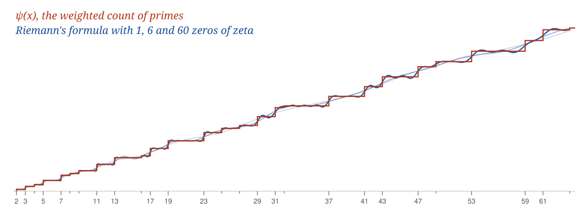
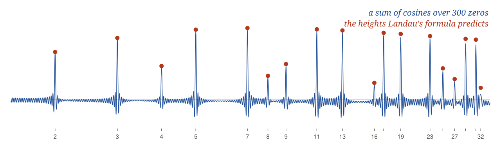
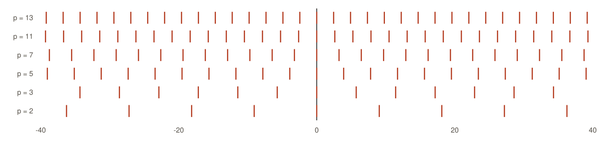
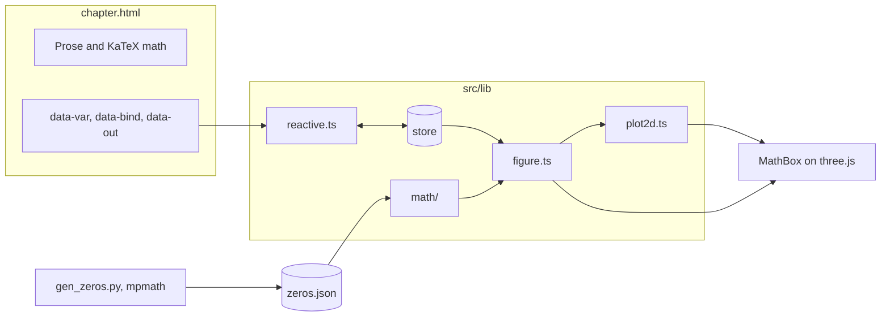
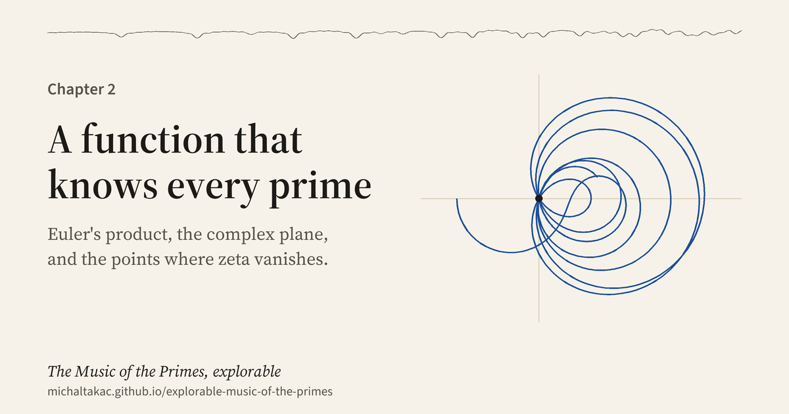
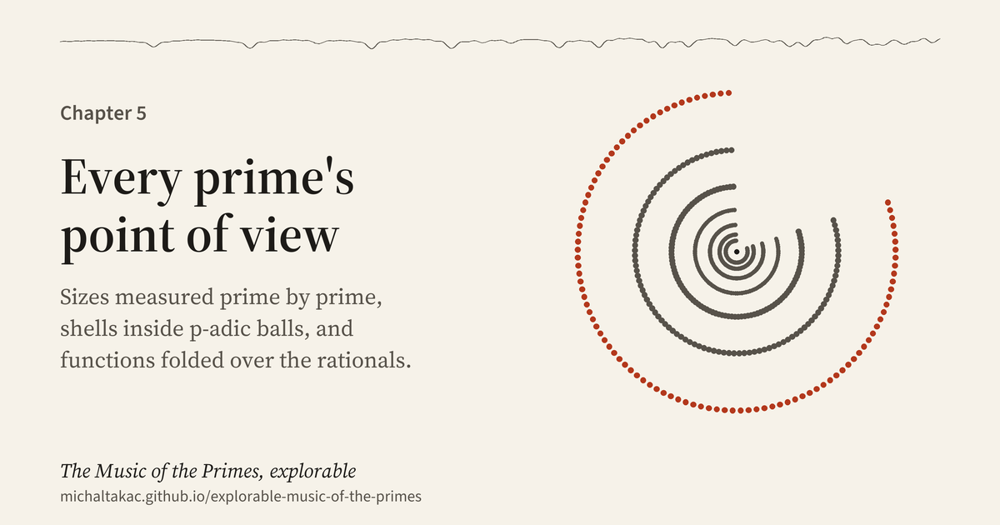

<picture>
  <source media="(prefers-color-scheme: dark)" srcset="docs/readme/hero-dark.svg">
  
</picture>

# The Music of the Primes, explorable

An explorable guide to Alessandro Maria Masullo's manuscript *The Music of the Primes* and to the
mathematics behind the generalized Riemann hypothesis. Nine pages of prose carry 29 live figures.
Drag a number in a sentence or a point in a figure, and everything that depends on it recomputes.

**Read it at [michaltakac.github.io/explorable-music-of-the-primes](https://michaltakac.github.io/explorable-music-of-the-primes/)**

> [!IMPORTANT]
> The manuscript is a proposed proof and has not been refereed. It was released as a draft on
> 20 November 2026 in [a post by Ravi Vakil](https://math216.wordpress.com/2026/11/20/hurried-announcement-alessandro-masullo-grh/),
> who writes that Brian Conrad has examined it closely for months and that it is so far looking good.
> This guide explains the ideas and the strategy as the author presents them. It does not vouch for
> the proof. The [status page](https://michaltakac.github.io/explorable-music-of-the-primes/status.html)
> lists what the current text contains and what is still unfinished.

## The mathematics in brief

### 1. A product over primes

Euler's identity ties a sum over all whole numbers to a product over the primes. It is unique
factorisation written as a formula.

```math
\zeta(s)\;=\;\sum_{n\ge 1}\frac{1}{n^{s}}\;=\;\prod_{p\ \mathrm{prime}}\frac{1}{1-p^{-s}}
```

### 2. A sum over zeros

Let $\psi(x)$ add up $\log p$ over every prime power $p^k \le x$. Riemann's explicit formula, in the
form proved by von Mangoldt, gives it exactly:

```math
\psi(x)\;=\;x\;-\;\sum_{\rho}\frac{x^{\rho}}{\rho}\;-\;\log 2\pi\;-\;\tfrac12\log\!\left(1-x^{-2}\right)
```

The sum runs over the zeros $\rho=\beta+i\gamma$ of zeta in the critical strip. Each pair of zeros
is one wave, with pitch $\gamma$ and size $x^{\beta}$. The figure at the top of this page is this
formula with 1, 6 and 60 zeros. The Riemann hypothesis says $\beta=\tfrac12$ for every zero: all the
waves play at the same volume.

### 3. The zeros find the primes

The formula runs backwards too. By a theorem of Landau (1911), for fixed $x>1$,

```math
\sum_{0<\gamma\le T}x^{\rho}\;=\;-\frac{T}{2\pi}\,\Lambda(x)\;+\;O(\log T)
```

where $\Lambda(x)=\log p$ when $x$ is a power of the prime $p$ and $0$ otherwise. A plain sum of
cosines over the zeros spikes at the prime powers and nowhere else.

<picture>
  <source media="(prefers-color-scheme: dark)" srcset="docs/readme/spikes-dark.svg">
  
</picture>

### 4. A trace computed twice

Wind the positive numbers into a loop by treating $x$ and $\gamma x$ as the same point. Smear
functions on the loop with a bump $\varphi$. The trace of that operation can be counted by the loop's
modes or by its closing points, and the two counts agree:

```math
\sum_{m\in\mathbf{Z}}\widehat\varphi\!\left(\frac{2\pi i\,m}{\log\gamma}\right)\;=\;\log\gamma\,\sum_{k\in\mathbf{Z}}\varphi\!\left(\gamma^{k}\right)
```

If the bump is supported strictly inside $(1,\gamma)$, the right side is zero. This is the toy
example in the manuscript's introduction. With $\gamma=p$, each prime becomes a loop of length
$\log p$.

## The manuscript's plan

The claim covers the L-function of every unitary Hecke character of every number field. The strategy,
as the introduction lays it out:

1. **Three spaces.** Functions on the idele class group, the adelic θ-functions inside them, and the
   quotient. After a Mellin transform the θ-functions are the multiples of $L(s+\tfrac12,\chi)$, so
   the quotient has one coordinate per zero.
2. **A room where far zeros are silent.** Complete everything in a Hilbert norm with weight
   $\max\{|g|^{2a},|g|^{-2a}\}$. A zero then contributes to the trace only if it lies within $a$ of
   the critical line.
3. **One prime at a time.** Replacing a $p$-adic ball by its outer shell removes one Euler factor.
   The piece removed is a copy of the loop above, so its trace is the loop count, which vanishes for
   every prime beyond the reach of the test function.
4. **Finitely many places remain.** Their trace was computed by Connes in 1998, and it gives the
   prime side of Weil's explicit formula. Since $a$ can be as small as one likes, no zero can lie off
   the line.

Step 3 needs the zeros of the factors $1-p^{-s}$ for different primes to stay apart. They form combs
with spacing $2\pi/\log p$, and two combs meet only at the origin because $\log p/\log q$ is never a
fraction.

<picture>
  <source media="(prefers-color-scheme: dark)" srcset="docs/readme/combs-dark.svg">
  
</picture>

## Chapters

| | Chapter | Things you can move |
|:-:|---|---|
| 1 | [Counting primes](https://michaltakac.github.io/explorable-music-of-the-primes/primes.html) | How far to count; the staircase against Gauss's curve; the tremor against $\sqrt{x}$ |
| 2 | [A function that knows every prime](https://michaltakac.github.io/explorable-music-of-the-primes/zeta.html) | The point $s$ in the complex plane; the spiral of partial sums; the height on the critical line; a 3D landscape of $\lvert\zeta\rvert$ |
| 3 | [Zeros as notes](https://michaltakac.github.io/explorable-music-of-the-primes/music.html) | How many zeros to use, with sound; one zero's wave; a made-up zero off the line |
| 4 | [The whole family of L-functions](https://michaltakac.github.io/explorable-music-of-the-primes/family.html) | The prime race mod 3 and mod 4; six characters and their zeros; Gaussian primes |
| 5 | [Every prime's point of view](https://michaltakac.github.io/explorable-music-of-the-primes/adeles.html) | A fraction's size on every ruler; the shells of a $p$-adic ball; the mirror $t\mapsto 1/t$ |
| 6 | [Two ways to count the same thing](https://michaltakac.github.io/explorable-music-of-the-primes/trace.html) | The bump on the loop, with both counts live; prime orbits in 3D; a window on the prime side |
| 7 | [The strategy of the manuscript](https://michaltakac.github.io/explorable-music-of-the-primes/proof.html) | The audible strip and an imagined zero; partial Euler products; the combs |
| | [Status, sources, glossary](https://michaltakac.github.io/explorable-music-of-the-primes/status.html) | |

## Design

The format follows Bret Victor's explorable explanations. The rules this guide holds itself to:

- The prose reads from start to finish without touching anything.
- A number in a sentence that could have been otherwise can be dragged, and so can every amber point
  in a figure. Each one also answers to the arrow keys.
- Each page has one state. The text, the tables and every figure on the page read from it, so a
  change shows up everywhere at once.
- Claims come with their numbers. Where two quantities are said to be equal, both are computed and
  printed side by side.
- Colour carries meaning: warm for the prime side, cool for the zero side, amber for anything you can
  grab.

## Under the hood



| Module | Job |
|---|---|
| [`src/lib/store.ts`](src/lib/store.ts) | A proxy-backed state object. Listeners run once per animation frame after any change. |
| [`src/lib/reactive.ts`](src/lib/reactive.ts) | Binds scrubbable numbers, sliders, buttons and computed text to the store. |
| [`src/lib/figure.ts`](src/lib/figure.ts) | Mounts a MathBox scene when a figure nears the viewport and frees its WebGL context when it leaves. |
| [`src/lib/plot2d.ts`](src/lib/plot2d.ts) | A 2D plotting layer. Curves and marks are MathBox primitives. Tick labels and handles are DOM elements, so every handle is a real, focusable slider. |
| [`src/lib/math/`](src/lib/math) | Prime sieve, $\psi$ and $\pi$, zeta and Dirichlet L-functions, the explicit formula. |
| [`src/pages/`](src/pages) | One file per chapter: its state, its sentences and its figures. |
| [`src/site.json`](src/site.json) | Titles, descriptions and addresses for every page. The header, the meta tags, `llms.txt` and the share cards all read from it. |

The figures use [MathBox](https://github.com/unconed/mathbox) 2.3 with three.js pinned to 0.139, the
version MathBox is tested against.

### Numerics

Everything is computed in the browser in double precision. Zeta and the L-functions go through the
Hurwitz zeta function, summed by Euler-Maclaurin with $N=\lfloor |t|/2\rfloor+26$ terms:

```math
\zeta(s,a)\;=\;\sum_{n=0}^{N-1}\frac{1}{(n+a)^{s}}\;+\;\frac{(N+a)^{1-s}}{s-1}\;+\;\frac{(N+a)^{-s}}{2}\;+\;\sum_{k=1}^{10}\frac{B_{2k}}{(2k)!}\,s(s+1)\cdots(s+2k-2)\,(N+a)^{-s-2k+1}
```

```math
L(s,\chi)\;=\;q^{-s}\sum_{a=1}^{q}\chi(a)\,\zeta\!\left(s,\tfrac{a}{q}\right)
```

| Check | Result |
|---|---|
| $\zeta(2)$ against $\pi^2/6$ | equal to the last digit of a double |
| $\zeta(-1)$ | $-0.08333333333333333$ |
| $\lvert\zeta(\tfrac12+i\gamma_1)\rvert$ at the first zero, $\gamma_1\approx14.1347$ | $5.6\times10^{-15}$ |
| $\lvert\zeta(\tfrac12+i\gamma_{30})\rvert$, $\gamma_{30}\approx101.3179$ | $3.5\times10^{-14}$ |
| $\lvert L(\tfrac12+8.0397\,i,\chi_3)\rvert$ at its first zero | $5.5\times10^{-13}$ |
| The two sides of the loop trace, default bump | both $1.04457$ |

The zeros themselves are not found in the browser. [`scripts/gen_zeros.py`](scripts/gen_zeros.py)
computes them with mpmath at 25 digits: the first 300 zeros of zeta, and for five Dirichlet characters
every zero with $|t|\le 60$, located as sign changes of a Hardy-type real function and then refined.

### For search engines and AI agents

Everything a crawler needs is rendered at build time by [`build/site-plugin.ts`](build/site-plugin.ts),
so nothing depends on running the page's JavaScript.

| Output | Purpose |
|---|---|
| Static header, chapter links, pager and footer in every HTML file | Navigation that exists without JavaScript |
| Default values baked into every live number | Complete sentences for readers, crawlers and the Markdown versions |
| `<link rel="canonical">`, Open Graph and Twitter tags | One address per page, and a preview card when a link is shared |
| JSON-LD (`WebSite`, `Article` with `LearningResource`, `BreadcrumbList`) | Tells a search engine what each page is and that it is based on a draft manuscript |
| [`sitemap.xml`](https://michaltakac.github.io/explorable-music-of-the-primes/sitemap.xml) | The list of pages |
| [`llms.txt`](https://michaltakac.github.io/explorable-music-of-the-primes/llms.txt) | A short map of the site for language models, with the facts they should not get wrong |
| `<page>.md` and [`llms-full.txt`](https://michaltakac.github.io/explorable-music-of-the-primes/llms-full.txt) | Every page as plain Markdown with LaTeX math, one file each and all together |
| [`data/zeros.json`](https://michaltakac.github.io/explorable-music-of-the-primes/data/zeros.json) | The zero tables as data |
| `og/<page>.png` | A 1200 by 630 card per page: its title, one line of description and a figure from that page |

The cards are drawn by [`scripts/og_images.py`](scripts/og_images.py) from the same data as the site,
in the site's own typefaces:

<p>
  
  
</p>

A project site on GitHub Pages cannot serve a `robots.txt` that crawlers honour, because that file
has to sit at the root of the host. The sitemap is therefore linked from every page and should be
submitted to search consoles by hand.

## Run it

```bash
npm install
npm run dev
```

| Command | Effect |
|---|---|
| `npm run build` | Writes the static site to `dist/`. |
| `npm run data` | Regenerates `src/data/zeros.json`. Needs Python with `mpmath`. |
| `npm run bake` | Writes the default value of every live number into the HTML, from `scripts/defaults.json`. |
| `npm run og` | Redraws the share cards in `public/og/`. Needs Pillow, fontTools and mpmath. |
| `npm run figures` | Redraws the figures on this page. |

A push to `main` deploys to GitHub Pages through
[`.github/workflows/deploy.yml`](.github/workflows/deploy.yml).

## Sources

- A. M. Masullo, [*The Music of the Primes*](https://math216.wordpress.com/wp-content/uploads/2026/11/the-music-of-the-primes.pdf), manuscript, 20 November 2026. The PDF is not kept in this repository.
- R. Vakil, [*Hurried Announcement: Alessandro Masullo GRH*](https://math216.wordpress.com/2026/11/20/hurried-announcement-alessandro-masullo-grh/), Math 216: Foundations of Algebraic Geometry, 20 November 2026.
- J. Tate, *Fourier analysis in number fields and Hecke's zeta-functions*, 1950.
- A. Weil, *Sur les "formules explicites" de la théorie des nombres premiers*, 1952.
- A. Connes, *Trace formula in noncommutative geometry and the zeros of the Riemann zeta function*, 1999.
- R. Meyer, *On a representation of the idele class group related to primes and zeros of L-functions*, 2005.
- B. Victor, [*Explorable Explanations*](https://worrydream.com/ExplorableExplanations/) and [*Up and Down the Ladder of Abstraction*](https://worrydream.com/LadderOfAbstraction/), 2011.

The guide was prepared with an AI model, Claude, from a reading of the full PDF. The manuscript,
according to its announcement, was written without AI. The guide is not affiliated with the
manuscript's author.

Code under the [MIT License](LICENSE).
